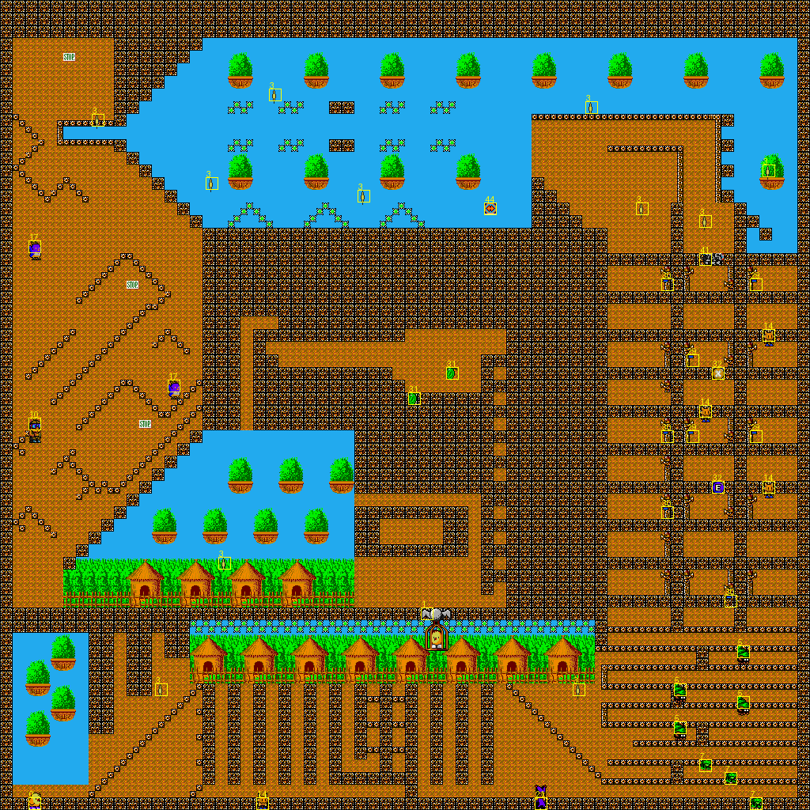
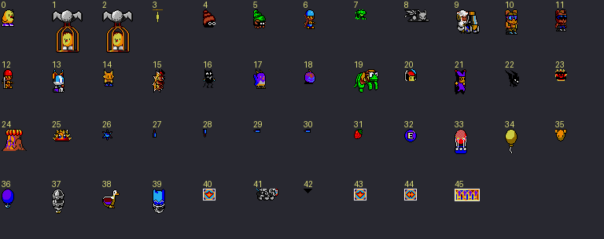

# The levels

The 20 levels (5 worlds of 4), their data, the objects each one places and the enemies its
generators let out, and the BOB frames each level can show. Extracted by `tools/levels/`
(run by `tools/assets/make_assets.sh`) into [`../assets/levels`](../assets/levels):

| | |
|---|---|
| `levelNN.png` | the whole map, each object the level places drawn where it starts (its type's first frame) in a yellow box with its type number; a generator's label also lists the types it lets out (`3>10,17`); the kiwi's start is type 0 |
| `levelNN_map.png` | the map alone |
| `bossNN.png` | the boss's BOB frames, on the 4th level of worlds 1, 2, 3 and 5 |
| `types.png` | each object type's first frame, numbered |
| `levels.json` | every level decoded (below), the object types and the generator programs |
| `scripts.json` | for each object type, the scripts its code can set and the frames they show (`scripts.py`) |
| `observed.json` | the frames, types and scripts each level drew when played in the emulator (`observe.py`) |
| `frames.json` | the frames each level can show, their size, and the check against `observed.json` (`frames.py`) |

## The level table

`LevelTable` (`$5DBA`): 20 entries of 16 bytes, indexed by `$8(a6)` (level × 16).

| Offset | |
|---|---|
| +0 long | the tile attributes: a word for each tile number, `$AAAA` ends. `sub_0C5C0` builds the collision map at `$462A6` from this and the map |
| +4 long | the object list (below), read by `sub_05AD4` |
| +8 long | the level's name, shown as it starts: `1_1` ... `5_4` (`_` is the font's dash), `$FF` ends. It sits just before the tile attributes |
| +C word | the first of the 5 tracks of the world's data |
| +E word | the track of the map |

### The world data

5 tracks, packed in the same format as the main program (`../tools/disk/pack.py`) and unpacked
in place at `$3CAA6`:

| Offset | |
|---|---|
| +0 | `01` |
| +2 | 16 colours, each stored as half its value (as every palette in the game) |
| +$80 | the 16×16 tiles, 128 bytes each: 16 lines, each line the 4 planes' words in turn |

Levels in the same world share these tracks: levels 4-7 all use tracks 22-26 and levels 12-14
use 52-56. The game reads them again at each level all the same (`LoadedLevel` only skips the
load when the same level restarts).

### The map

1 track, loaded at `$44AA6`:

| Offset | |
|---|---|
| +0 | `01` |
| +2 word | width in tiles |
| +4 word | height in tiles |
| +$10, +$12 | two words the game never reads (0-$37: perhaps where the map editor's cursor was) |
| +$80 | the rows, 64 bytes each (one byte a tile), **the top row last**: row R (from the top) is at +$80 + (height − 1 − R) × 64 |

`sub_0C5C0` sets the camera's limits from it: x up to width × 16 − `$130`, y up to
(height − 11) × 16; `$C(a6)` = (height − 1) × 64. Level 15 (4-4) is forced to 32 columns.

### The object list

| | |
|---|---|
| word | the level's time (at least `$28`; to `(a6)`, counted down by the CIA-B timer) |
| 4 bytes | the kiwi, as an object entry: type (0) and parameter are skipped, x and y (tiles) are his start - unless he restarts where he died (`$7C(a6)`) |
| 4 bytes each | the objects: type, x, y (tiles: placed at x × 16 + 4, y × 16), parameter. A negative type ends the list |

The parameter: `$FF` none. For type 3, its generator program (below). For the others, bit 7
moves the object 8 pixels right and bits 0-6 × 2 is where in its animation script it starts
(`$22`). Every placed object but type 32 is turned to face the kiwi (`sub_08B9A`).

### Generators

Type 3 is a generator: a door in the scenery that opens when the kiwi comes near and lets
enemies out. Most of a level's enemies come from these, not from the object list. Its handler
(`sub_05F2C`, `sub_05F72`) runs a program from `dat_05C0A`: a word (the number of programs × 2),
then a word for each program, its offset from that word. A program:

| | |
|---|---|
| 2 words | how near the kiwi must be (x, y distance in pixels) |
| type, 3 bytes | let out an enemy of the type (0-`$7F`), at the door, facing the kiwi (the 3 bytes are not used) |
| `$FE` n | wait n passes |
| `$FC` / `$FD` | open / close the door (scripts `$6070` / `$607E`: frames 160-165) |
| `$FB` | stop |
| `$FF`, then a long at the next even address | go on with that program (each one loops to itself) |

| Program | Lets out | |
|---|---|---|
| 0 | 10 | near 32,160: open, type 10, close, again |
| 1 | 17 | near 32,48: open, type 17, close, again |
| 2, 18 | 23 | near 160,20: open, type 23, close, wait 100, again |
| 3 | 12 | near 50,100: open, type 12 × 4 (wait 15 between), close, again |
| 4 | 22 | near 100,100: open, type 22 × 2 (wait 10), close, again |
| 5 | 13 | near 100,100: open, type 13, close, again |
| 6 | 4, 5, 6 | near 100,100: open, types 4, 4, 5, 6 (wait 25), close, again |
| 7 | 6 | near 100,100: open, type 6 × 2 (wait 25), close, again |
| 8 | 20 | near 16,32: open, type 20, close, wait 200, again |
| 9 | 11 | near 100,100: open, type 11 × 2 (wait 35), close, again |
| 10 | 8, 23 | near 80,100: open, types 8, 23, close, wait 200, again |
| 11 | 19 | near 180,50: open, type 19 × 2 (wait 25), close, wait 200, again |
| 12 | 18 | near 80,150: open, type 18, close, again |
| 13 | 21 | near 80,150: open, type 21, close, wait 200, again |
| 14 | 7, 14 | near 80,150: open, types 14, 7, 14, 14 (wait 5), close, wait 50, again |
| 15 | 15 | near 100,150: open, type 15, close, wait 200, again |
| 16 | 16 | near 100,150: open, type 16, close, wait 200, again |
| 17 | 8 | near 80,100: open, type 8, close, wait 200, again |

### The boss's frames

On the 4th level of a world (`(level + 1) & 3 = 0`), the loader (`$4170`) reads 2 more tracks
to `$6C000`, the first from `ExtraTracks` (`$418C`) by world: 158, 156, 154, none, 152. They
hold `$2A00` bytes of frames, stored as the main bank's, then their directory (as the main
bank's, offsets from the start). The frames are deinterleaved and copied to `$613A6`, and the
directory appended at `$3BED6`: they are frames 579 on (the main bank is 0-288, its mirrored
copies 290-578). The caged kiwi of those levels (type 2) has the scripts that show them.

| Level | Tracks | Frames | Bytes |
|---|---|---|---|
| 3 (1-4) | 158-159 | 26 | 6,634 |
| 7 (2-4) | 156-157 | 9 | 8,986 |
| 11 (3-4) | 154-155 | 21 | 9,094 |
| 19 (5-4) | 152-153 | 10 | 8,910 |

## The levels

| Level | | Size (tiles) | World tracks | Map track | Time | Objects | Types placed | Generators (types let out) | Frames it can show (drawn in play) | Their size | Boss tracks, frames |
|---|---|---|---|---|---|---|---|---|---|---|---|
| 0 | 1-1 | 64×14 | 2-6 | 18 | 80 | 12 | 1, 4, 5, 6 | - | 122 (58) | 40.8 KB | - |
| 1 | 1-2 | 64×32 | 6-10 | 19 | 100 | 22 | 1, 4, 5, 6, 7, 14, 18, 32, 33 | 0 (10) | 163 (95) | 53.8 KB | - |
| 2 | 1-3 | 64×32 | 11-15 | 20 | 240 | 19 | 1, 4, 14, 25, 32 | 0, 1 (10, 17) | 134 (75) | 46.5 KB | - |
| 3 | 1-4 | 64×64 | 14-18 | 21 | 280 | 34 | 2, 4, 5, 6, 7, 11, 14, 24, 32 | 0-5 (10, 12, 13, 17, 22, 23) | 213 (150) | 68.8 KB | 158-159, 26 |
| 4 | 2-1 | 64×64 | 22-26 | 25 | 440 | 41 | 1, 5, 7, 10, 14, 17, 21, 29, 30, 31, 32, 41, 44 | 0-4, 7-11 (6, 8, 10, 11, 12, 17, 19, 20, 22, 23) | 227 (150) | 73.1 KB | - |
| 5 | 2-2 | 64×64 | 22-26 | 26 | 440 | 43 | 1, 4, 5, 6, 24, 31, 32 | 0, 1, 5, 7, 9-11, 13 (6, 8, 10, 11, 13, 17, 19, 21, 23) | 219 (132) | 71.8 KB | - |
| 6 | 2-3 | 64×64 | 22-26 | 27 | 440 | 34 | 1, 4, 5, 24, 31, 32, 44 | 0, 1, 3-5, 7, 9-11, 14 (6, 7, 8, 10-14, 17, 19, 22, 23) | 224 (146) | 71.6 KB | - |
| 7 | 2-4 | 64×64 | 22-26 | 28 | 440 | 35 | 2, 24, 27, 28, 29, 30, 31 | 0-4, 6, 7, 9, 11, 14 (4-7, 10-12, 14, 17, 19, 22, 23) | 209 (151) | 69.1 KB | 156-157, 9 |
| 8 | 3-1 | 64×64 | 29-33 | 48 | 240 | 35 | 1, 9, 10, 11, 14, 17, 31 | 0-4, 9, 11, 12, 15, 16 (10-12, 15-19, 22, 23) | 200 (131) | 68.5 KB | - |
| 9 | 3-2 | 64×64 | 34-38 | 49 | 240 | 27 | 1, 23, 24, 32 | 0-3, 5, 6, 8, 9, 14, 15 (4-7, 10-15, 17, 20, 23) | 214 (130) | 67.2 KB | - |
| 10 | 3-3 | 64×64 | 39-43 | 50 | 240 | 31 | 1, 25, 32, 43, 45 | 0-4, 7, 9, 11, 12, 14, 15 (6, 7, 10-12, 14, 15, 17-19, 22, 23) | 201 (135) | 65.3 KB | - |
| 11 | 3-4 | 64×64 | 44-48 | 51 | 360 | 33 | 2, 10, 11, 14, 17, 18, 24, 26, 32 | 0-4, 8-11, 13-16 (7, 8, 10-12, 14-17, 19-23) | 256 (154) | 83.1 KB | 154-155, 21 |
| 12 | 4-1 | 64×64 | 52-56 | 56 | 360 | 33 | 1, 14, 24, 25, 26, 32 | 0, 1, 4, 5, 9, 11, 16 (10, 11, 13, 16, 17, 19, 22) | 174 (120) | 59.6 KB | - |
| 13 | 4-2 | 64×64 | 52-56 | 57 | 360 | 16 | 1, 24, 25, 26 | 0, 3, 5, 9, 11, 14 (7, 10-14, 19) | 170 (100) | 58.0 KB | - |
| 14 | 4-3 | 64×64 | 52-56 | 58 | 360 | 22 | 1, 21, 24, 26, 32 | 0, 1, 9, 11, 14, 15 (7, 10, 11, 14, 15, 17, 19) | 208 (130) | 69.4 KB | - |
| 15 | 4-4 | 32×48 | 59-63 | 68 | 480 | 21 | 2, 5, 6, 14, 21 | 0, 1, 3, 5, 9, 11, 12, 16 (10-13, 16-19) | 237 (145) | 77.8 KB | - |
| 16 | 5-1 | 64×64 | 70-74 | 79 | 480 | 25 | 1, 14 | 0, 1, 3-5, 7-12, 14, 15 (6-8, 10-15, 17-20, 22, 23) | 221 (129) | 70.5 KB | - |
| 17 | 5-2 | 64×64 | 74-78 | 80 | 480 | 26 | 1, 14, 21 | 0-2, 4, 10 (8, 10, 17, 22, 23) | 189 (87) | 62.3 KB | - |
| 18 | 5-3 | 64×64 | 81-85 | 88 | 480 | 21 | 1 | 0, 1, 3-5, 8-12, 15, 16 (8, 10-13, 15-20, 22, 23) | 200 (120) | 65.1 KB | - |
| 19 | 5-4 | 64×64 | 84-88 | 89 | 800 | 19 | 2, 14 | 1-4, 8-10, 14-16 (7, 8, 11, 12, 14-17, 20, 22, 23) | 182 (93) | 59.6 KB | 152-153, 10 |

Some levels' world tracks overlap the next level's (2 and 3, 16 and 17, 18 and 19): the packed
data is shorter than 5 tracks, and the loader always reads 5.

## Object types

`dat_05854`: 46 types (0-45) of 12 bytes. Objects made from it (`sub_057D8`, `sub_057E8`) keep
their type at `$1C`.

| Offset | |
|---|---|
| +0 long | the handler (the object's `$18`), called each pass |
| +4 long | the animation script (`$14`) |
| +8 word | the frames between script steps |
| +A word | a linked type, created with it (0: none) |

What the code shows (each handler's header box in `nzs_main.s` has the details):
* 0: the kiwi. 1, 2: the caged kiwi; 2 on the 4th level of each world, with the boss.
* 3: a generator (above).
* 10-13 and 15-20: enemies that ride. Each has a linked type from 33-41 (what it rides: the
  balloons, the duck, ...), created with it. `dat_05A7C` (by type − 10, 10-21) holds each one's
  attack routine, reached through an indirect jump (`$6F64`), and the script it falls with when
  knocked off. Type 22's linked type is 42, the thing it carries and drops.
* 27-30: not animated by a script: the handler (`$6DA4`) shows the first word of the "script"
  as a frame and reads its third as a time.
* 31: fruit. An enemy that dies becomes a fruit (type `$FFFE`, script `dat_07414` entered at
  one of 16 fruits in turn, `$073C0`).
* 32: an EXTEND letter: 1,000 points, a bit of `$13(a6)` set, the letter drawn on the panel.
* 4: walks and rolls a shot along the ground; 5: walks and fires across; 6: leaps at the kiwi and
  throws a boomerang; 7: hops, and near the kiwi bursts into 5 pieces; 8: bounces diagonally;
  9: walks and throws a piece up; 14: leaps at the kiwi and makes copies of itself; 21: leaps,
  and throws an egg that hatches into a random enemy (`sub_085E6`); 22: walks carrying a type 42
  and drops it on the kiwi; 23: falls, lands and lets out walking copies of itself; 24: lurks
  below and reaches up to catch the kiwi (a life lost); 25: walks, deadly to touch; 26: bounces
  about.
* The riders (10-13, 15-19): each type's handler picks one of six flights (`l_06ECA`: the
  self-modified `jsr` at `$6F1E`) and one of the attacks in `dat_05A7C` (a shot across, aimed,
  dropped or thrown up); 20 rides type 41 and fires its spread.
* 33-41, the rides: the kiwi boards them from above (`sub_0635A`) and steers them
  (`sub_08E1E`); a shot or spikes pop them. 39 trails 4 segments that hurt the kiwi, or the enemies while he rides it; 41 fires a
  spread of 8 when ridden.
* 43-45, platforms: 43 sinks when stood on, 44 is pushed the way the kiwi faces, 45 is a lift.
* Bonus items (fruit's every 8th, `$28(a6)`): weapons (`sub_07672`, `sub_07680`, `sub_07694`,
  the bow back `sub_0768A`), the clock, the bomb, invincibility, a flight straight to the cage
  (`sub_07618`).
* An enemy shot or knocked over is type `$FFFF`; `sub_085E6` turns an object into a random one
  of 16 enemies (the table at `dat_08628`: handler and script pairs).

### Animation scripts

A script is a list of words. A positive word is a frame number + 1 (0: no frame this step).
A negative word is a command, `$8000 | n`:

| n | | Arguments |
|---|---|---|
| `$00` | start the script again | |
| `$04`, `$08` | set dx, dy | word |
| `$0C`, `$10` | add to x, y | word |
| `$14`, `$18` | set x, y | word |
| `$1C` | go to | long |
| `$20` | loop count (negative: a random count) | word |
| `$24` | loop | |
| `$28` | the frames between steps | word |
| `$2C`, `$30`, `$34`, `$38` | compare x / y, and go to a script if so | word, long |
| `$3C` | end the object | |
| `$40` | mirror (toggle `$10`) | |
| `$44` | set a field | offset word, value word |
| `$48` | clear the speed: the script stops here | |
| `$4C` | call code | long |

A script is often entered part-way: the object list's parameter and the code set its position
(`$22`), and many scripts go on after a `$8000` with more steps that are only reached that way.

## The frames each level can show

The main BOB bank holds 289 frames (93,706 bytes). At start-up `sub_0C52C` builds a mirrored
copy of every one (`$4A3A6` on, the same size again, over the intro's picture): a mirrored
frame is drawn as frame + `$122`. So about 187 KB of chip RAM holds BOB graphics on every level.

### Found from the code

An object's frame (`$12`) is written in one place only: the animation interpreter (`$B2C0`),
from its script. So the frames an object can show are those of the scripts its code can give it.
`tools/levels/scripts.py` finds them for each type, from the traced disassembly:

* the type's script, and every script the code reachable from its handler puts in an object's
  `$14` or passes to `sub_0B4E2` / `sub_0B4E4` (the object makers) - directly, or through
  tables of scripts (`dat_0862C`, 8 bytes apart, the random enemy);
* the scripts those go to, and the code they call (`$804C`);
* the handlers that code installs (`$18`, including tables of them) and the types it makes,
  followed in turn; for types 10-21 also their entries in `dat_05A7C`;
* a script's whole block: from its start, past its restarts, up to the next script, label or
  code (so the steps reached through `$22` are counted).

Where the trace did not reach, the code is decoded on the fly (433 instructions). The panel
and the screens between levels draw a few frames without a script (`sub_0B69A`, `BlitBob`): the
lives, the oxygen gauge and the EXTEND letters, added by hand (`scripts.PANEL`).

A level can then show the **common** frames (62: those set by the code reachable from the
game's entry points and interrupts - the kiwi, the score - and the panel's) and
those of every type it can have: placed, let out by its generators, and all those make in turn.

### Checked by playing

`tools/levels/observe.py` plays each level in `tools/nzsemu` 3 times (99 lives, a random
joystick, the kiwi moved to each placed object in turn; not to the caged kiwi, and only what is
drawn before the level changes counts) and logs every call of `BlitBob` with the frame, the
object's type, script and mirror flag. **Every frame drawn is in its level's set from the code**
(`frames.json`). The plays draw about 60 % of it: fruit, for example, is one of 16 in turn and
a few minutes' play shows a handful.

### What it could save

| | Frames | Bytes |
|---|---|---|
| The main bank | 289 | 93,706 |
| Its mirrored copies | 289 | 93,706 |
| Shown on some level | 277 | 91,808 |
| The most one level can show (11, 3-4) | 256 | 85,114 |
| The most one world can show (levels 4-7) | 247 | 82,608 |
| Drawn mirrored in play, on one level at most (7, 2-4) | 128 | 40,232 |
| Drawn mirrored in play, on any level | 209 | 67,636 |

Not found in any script or play: 16, 31-33 (kiwi colourings), 38, 76, 209 and 211-214 (scores
of 400-900), 232: 12 frames. Frame 16 was drawn once in an earlier run that went on into the
next level, so these are not proven unused.

So keeping only the frames a level or a world can show saves little for the frames themselves
(9-53 KB a level, 9 KB on the busiest). The mirrored copies are the waste: a level draws at most
about 40 KB of them in play, of the 94 KB built. Since nearly every object can turn round, the
code cannot rule a frame out of being mirrored; the safe way to save that memory is to **mirror
on demand**: build a mirrored frame the first time it is drawn mirrored, into a cache (about
48 KB would hold any level's in these plays), and when the cache is full drop the least
recently used. That frees about 45 KB of chip RAM on 512K.

## Still to do

* The bosses: their objects and code (type 2's scripts show frames 579-596).
* More plays for `observed.json`.
